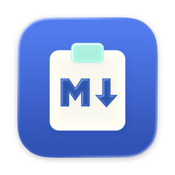
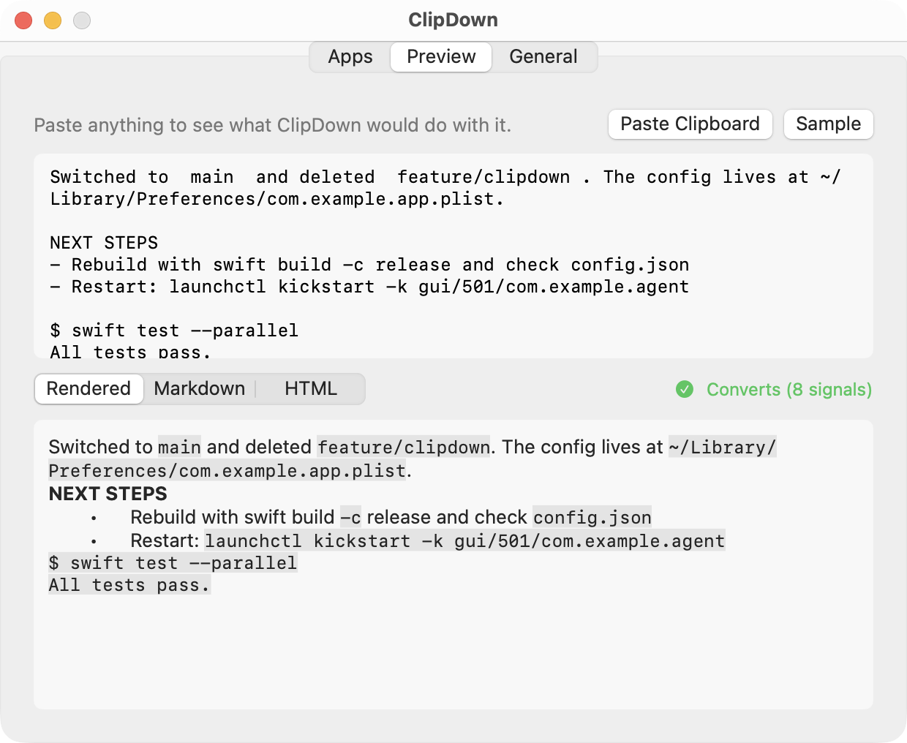
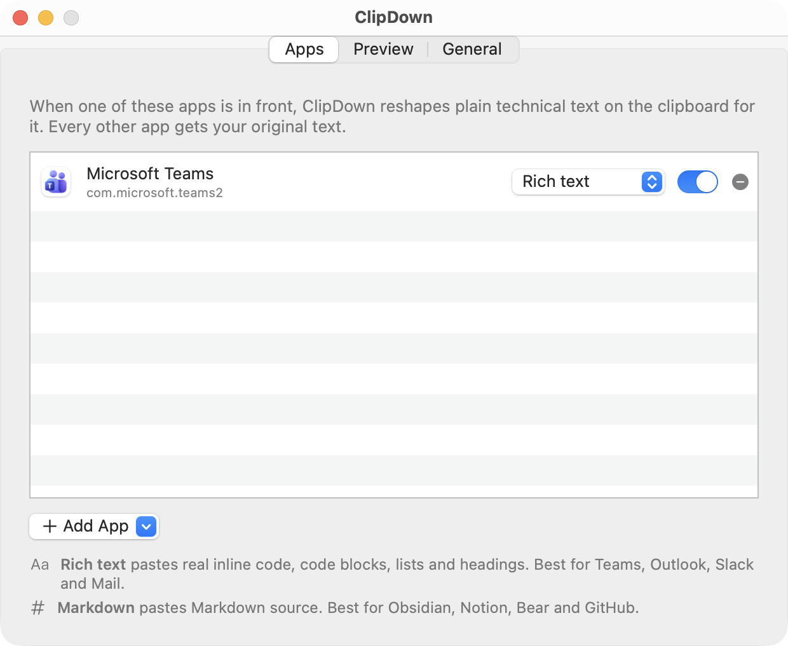

<p align="center">
  
</p>

<h1 align="center">ClipDown</h1>

<p align="center"><b>Copy from the terminal. Paste into Teams. Keep the formatting.</b><br>
A tiny macOS menu bar app that reshapes your clipboard for whichever app you're pasting into.</p>

---

I live in the terminal. Claude Code writes me beautiful answers full of `inline code`, commands, file paths and little box-drawn tables. Then I copy one into Teams to share it and... mush. Every backtick is gone, every command is just more prose, and the table collapses into a wall of pipes.

Pasting Markdown doesn't help either. Teams only formats Markdown you *type*. Paste `**bold**` and you get two asterisks on each side.

So I built ClipDown. It notices when you switch to an app like Teams, looks at what's on the clipboard, and if it's technical text that lost its formatting, it quietly adds a rich-text version. Paste, and the code is code again.

It just works. No hotkey, no extra step.



## How it works

1. **You copy as usual.** From Claude Code, Ghostty, Terminal, iTerm, a log file, anywhere.
2. **You switch to an app in your list.** ClipDown checks the clipboard. Plain prose is left alone. Technical text gets reshaped for that app:
   - **Rich text** apps (Teams, Outlook, Mail, Notes) get real inline code, code blocks, lists and headings.
   - **Markdown** apps (Slack, Obsidian, Notion, Discord) get clean Markdown source instead, and format it themselves.
3. **Every other app gets your original text back.** Switch to your editor or terminal and the clipboard is exactly what you copied. ClipDown never leaves a surprise behind.

## Install

ClipDown needs macOS 15 or later. Releases are signed with a Developer ID, notarized by Apple, and update themselves through [Sparkle](https://sparkle-project.org).

**Homebrew** (puts the `clipdown` command on your PATH too):

```bash
brew install --cask omarshahine/tap/clipdown
```

**Direct download:** grab `ClipDown.zip` from the [latest release](https://github.com/omarshahine/clipdown/releases/latest), unzip it, and drag ClipDown into Applications.

Open it once and it adds itself to your login items. You'll find it in the menu bar. The first time ClipDown reads the clipboard, macOS may ask whether it can paste from other apps. Choose **Allow**. That's the whole point of the app.

New versions arrive on their own: ClipDown checks once a day, and **Check for Updates…** in the menu checks now. Turn automatic checks off in **Settings > General**.

**From source** (needs Xcode 26 or later):

```bash
git clone https://github.com/omarshahine/clipdown.git
cd clipdown
scripts/install.sh      # builds into ~/Applications; scripts/uninstall.sh removes it
```

## Pick your apps

ClipDown starts with Microsoft Teams. Open **Settings** from the menu bar icon to add more. Pick from suggestions (Slack, Outlook, Mail, Notes, Word, Obsidian, Notion, Bear, Discord, Linear, Claude, ChatGPT), any running app, or any app on disk, and choose **Rich text** or **Markdown** for each one.



Prefer the terminal? Same settings, same file:

```bash
clipdown targets                          # what ClipDown converts for
clipdown add com.tinyspeck.slackmacgap    # Slack (suggested format: Markdown)
clipdown add com.apple.mail --rich-text   # Mail, rich text
clipdown remove com.apple.mail
clipdown disable                          # or enable
```

Find any app's bundle ID with `osascript -e 'id of app "Slack"'`.

## What it recognizes

ClipDown uses fast, predictable heuristics. No AI model, and your clipboard never leaves your Mac.

| In the copied text | Becomes |
|---|---|
| Inline code from Claude Code (it pads code with invisible non-breaking spaces) | `inline code` |
| A word or command wrapped in double spaces (other terminals) | `inline code` |
| Paths, `--flags`, `file.ext`, `ENV_VARS`, `call()`, `snake_case`, `camelCase` | `inline code` |
| `"quoted commands"` and `Install: brew install --cask foo` | `inline code` |
| Shell prompts (`$ `, `PS C:\>`), command lines, JSON, HTML source, indented runs | code blocks |
| Box-drawing tables (`┌──┬──┐`) | a code block, so the columns stay lined up |
| Short ALL-CAPS lines | headings, when the clip also has code |
| `-`, `*`, `•` and `1.` lines | lists, when the clip also has code |
| Markdown already in the text (`**bold**`, backticks, fences, tables) | rendered |

And it deliberately leaves these alone:

- Ordinary prose ("Lunch at noon works for me.")
- Anything that's already formatted (HTML or RTF on the clipboard), images and files
- A single word, URL or filename you're about to drop into a sentence
- Passwords and anything a password manager marks as concealed
- Clips over 50 KB

Not sure what it'll do? The **Preview** tab in Settings shows the result for anything you paste in, rendered, as Markdown, or as raw HTML.

## Privacy

- Your clipboard never leaves your Mac. No analytics, no AI service.
- The only network request is the daily update check, which fetches a release feed from GitHub. Sparkle sends no system profile, and you can turn checks off in Settings.
- Reads the clipboard only while an app in your list is in front, and only after the clipboard's type list says it's plain text.
- Skips anything marked concealed or transient (the [nspasteboard.org](http://nspasteboard.org) conventions password managers use).

## Plays nice with clipboard managers

Pastebot, Raycast, Maccy and friends will keep seeing just your original copy. ClipDown tags what it writes with `org.nspasteboard.AutoGeneratedType`, so they don't record a duplicate entry. Pasting an old clip from your manager's history into Teams gets converted too.

## FAQ

**Why not bold and italics too?** The terminal throws that information away, so ClipDown would have to guess. A wrong guess bolds random words in a work chat, which is worse than no bold at all. Markdown that's already in your text (`**like this**`) is rendered.

**Does it work with my terminal?** Yes. Claude Code's inline code survives best, because it leaves a reliable fingerprint. Commands, paths, tables and the rest work from any terminal.

**Can I convert on demand, for any app?** Use **Convert Clipboard Now** in the menu bar, or `clipdown --convert-now [--markdown]`.

**How do I see what it would do from the command line?** `pbpaste | clipdown --dry-run` prints the Markdown. `--html` prints the HTML.

## Development

```bash
swift test                     # the converter, renderer and settings tests
swift run clipdown --dry-run < some-terminal-output.txt
scripts/install.sh             # build and install the app
```

| Path | What's there |
|---|---|
| `Sources/ClipDownCore/Converter.swift` | Plain text to Markdown heuristics |
| `Sources/ClipDownCore/Renderer.swift` | Markdown to the HTML chat apps accept |
| `Sources/ClipDownCore/Policy.swift` | What to touch and what to leave alone |
| `Sources/ClipDownCore/Settings.swift` | Target apps and formats |
| `Sources/clipdown/Engine.swift` | Watches the frontmost app and reshapes the clipboard |
| `Sources/clipdown/App.swift`, `SettingsView.swift` | Menu bar app and Settings window |
| `Resources/ClipDown.icon` | The app icon, an Icon Composer document |

Found text that converts badly? Open an issue with a sample (scrub anything private) and what you expected. Every false positive I've found has become a test.

## License

MIT. See [LICENSE](LICENSE).
